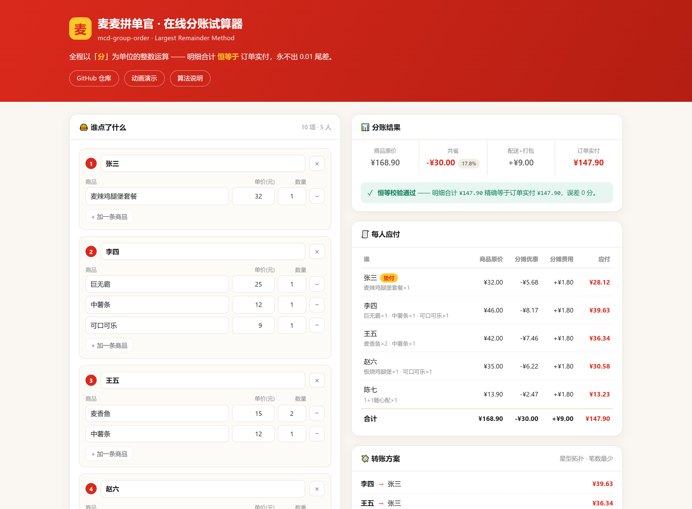

<div align="center">

# 🍟 麦麦拼单官

**群里 8 个人点麦当劳，从报单到算清「谁该转谁多少钱」，只要一次对话。**

把群聊记录丢进来 → 有人只写「随便」也自动安排口味 → 逐张试算券挑出最省的 → 一键下单 → 输出精确到分的 AA 分账图。

**MCP Token&#x20;**


### 👉 [**在线试算器 · 打开即用**](https://zxz-fine.github.io/mcd-group-order/) 👈

<sub>不用装任何东西。填人数和金额，实时看分账结果与「合计恒等」校验。</sub>

</div>


<p align="center"><sub>粘贴群聊记录 → 解析报单 → 券逐张试算 → 精确分账 → 生成卡片（完整流程约 9 秒）</sub></p>



<p align="center"><sub><a href="https://zxz-fine.github.io/mcd-group-order/">在线分账试算器</a> —— 纯前端确定性算法，浏览器里算，不上传任何数据</sub></p>

---

## 拼单真正的麻烦，从来不是点单

点单只是一句话的事。麻烦在后面：

- **券怎么用最省？** 卡包里躺着一堆券，但麦当劳的券**按商品绑定、看不到面额、一次还只能用一张**——
  想知道哪张最省，只能逐张拿去算价；靠肉眼挑，纯属碰运气。
- **优惠怎么分才不吵架？** 满 100 减 20，是 5 个人均摊每人省 4 元？还是买得多的人省得多？  
  还是谁用自己的券谁受益？——这是拼单群里 90% 争执的来源。
- **有人只回一句「随便」。** 8 个人的群里总有两三个「随便」，得挨个追问；
  就算替他点，还得避免跟别人撞口味、还得记着谁不吃辣——比问清楚还累。
- **账算不对。** 3 个人均摊 10 元配送费，每人 3.333… 元，四舍五入后合计 9.99，少的那一分谁补？

「麦麦拼单官」就是为这四件事做的。

---

## 它能做什么

| 能力            | 说明                                                                                   |
| ------------- | ------------------------------------------------------------------------------------ |
| 🗣 **报单解析**   | 直接粘贴群聊记录。支持 `@昵称` / `昵称：` / `昵称 ` 三种前缀，`x2`/`2个`/`两个` 三种数量写法，自动抽备注（去冰、不要生菜）          |
| 🎯 **菜单匹配**   | 把「中薯」「板烧」这类口语名，模糊匹配到门店真实餐品编码；拿不准的**不猜**，交回人工确认                                       |
| 🙋 **泛称指派**   | 有人只报一句「随便」？自动指派汉堡：多人时**尽量不重样**、**避开别人已点的**、**照顾忌口**（「不要辣」不会给麦辣鸡腿堡），`随便 x2` 拆成两个不同口味。指派结果必须经用户确认 |
| 💰 **单券择优**   | 建立「券 ↔ 购物车商品」映射（券用的是「活动虚拟编码」，需 `productCode` 精确匹配 + 商品名降级匹配）→ 逐张调 `calculate-price` 权威试算 → 选出实付最低的那张。用不上的券会给出原因（如「购物车里没有薯条」） |
| 🧾 **精确分账**   | 最大余额法分摊，**Σ(每人应付) 恒等于订单实付**，永不出现 0.01 尾差                                             |
| ⚖️ **三种分账口径** | 把「优惠怎么分」变成显式选项，而不是争吵点                                                                |
| 🖼 **分账卡片**   | 生成自包含 HTML，截图直接发群；含转账清单                                                              |

---

## 快速开始

### 1. 申请麦当劳 MCP Token

访问 [麦当劳 MCP 开放平台](https://open.mcd.cn/mcp) → 手机号登录 → 控制台 → 激活 → 复制 Token。

### 2. 在 WorkBuddy 中配置连接器

在 WorkBuddy 左侧边栏【专家·技能·连接器】→【连接器】→ 右上角【自定义连接器】→【配置 MCP】，  
填入 [`mcp-config.example.json`](./mcp-config.example.json) 的内容，**把 `${MCD_MCP_TOKEN}` 换成你的真实 Token**  
（或先设置同名环境变量），保存并启用。

### 3. 安装技能

```bash
git clone https://github.com/zxz-Fine/mcd-group-order.git
cp -r mcd-group-order/skills/mcd-group-order ~/.workbuddy-ai/skills/
```

### 4. 在对话里粘贴群聊记录

```
@张三 麦辣鸡腿堡套餐 x1
李四：巨无霸 + 中薯 + 可乐
@王五 2个麦香鱼 1份薯条 不要番茄酱
赵六：板烧鸡腿堡 去冰可乐
```

「麦麦拼单官」会依次完成：定位门店 → 拉菜单 → 匹配餐品 → 逐张试算券 → 分账 → 出图。

---

## 在线分账试算器

不想装任何东西？直接打开 **[zxz-fine.github.io/mcd-group-order](https://zxz-fine.github.io/mcd-group-order/)**。

> **部署者注意**：GitHub Pages 必须由仓库管理员**手动启用一次**（GitHub 硬性要求，
> 默认 `GITHUB_TOKEN` 无法自动完成）。打开
> [`settings/pages`](https://github.com/zxz-Fine/mcd-group-order/settings/pages)，
> Source 二选一：**「Deploy from a branch」→ `main` + `/docs`**（最快，无需工作流），
> 或 **「GitHub Actions」**（之后每次改 `docs/` 自动部署）。
> 详见 [`.github/workflows/pages.yml`](./.github/workflows/pages.yml) 顶部的说明。

它是一个纯静态单文件页面（`docs/index.html`），把 `split_bill.py` 的分账引擎用浏览器 JS 复刻了一遍：

- 输入谁点了什么、优惠多少，**实时**看每人应付与转账方案；
- 一张表对比**三种分账口径**下各人差多少；
- 顶部常驻**恒等校验**徽章：`Σ(每人应付)` 是否精确等于订单实付；
- 一键复制 Markdown 分账单，直接贴群；
- 支持粘贴 JSON（与 `split_bill.py` 输入格式一致）批量导入。

**全程在浏览器里算**，无后端、无网络请求、不上传任何数据。

### 前端和后端会不会算出两个结果？

这是复刻算法最大的风险——**代码悄悄漂移**，页面上还照样显示「校验通过」（因为它校验的是它自己）。

所以仓库里有一道专门的锁：`tests/test_frontend_parity.py` 不比对「我复制的代码」，而是**直接加载要发布的那份 HTML**，在 Node 里跑，再和 `split_bill.py` 逐字段比对 `shares` / `summary` / `transfers` / Markdown 全文——包括 **240 组随机账单**。一旦出现 1 分钱差异，测试立刻红。

```bash
python -m unittest tests.test_frontend_parity -v   # 8 项
node tests/shot.js                                 # 可选：用本机 Chrome 做可视检查
```

---

分账最容易吵架的不是「点了什么」，而是「优惠怎么分」。所以这里不替你做决定，而是把口径摆出来：

| 口径              | 权重     | 适合              |
| --------------- | ------ | --------------- |
| **按商品原价比例**（默认） | 各人商品金额 | 买得多的人分摊更多优惠，最公平 |
| **按人头均摊**       | 人人相等   | 大家金额差不多，图省事     |
| **谁用券谁受益**      | 券持有人独占 | 券是某人自己的，人情归人家   |

配送费/打包费另有一套口径（均摊 / 按比例）。

### 为什么不会出现 0.01 的尾差

金额全程以「分」为单位的**整数**运算，分摊使用**最大余额法**：

1. 按权重算理论份额 $r_i = T \cdot w_i / W$
2. 下取整得到 $b_i$
3. 余数 $R = T - \sum b_i$ 按小数部分从大到小，逐一分配 1 分

数学上 $\sum (b_i + \Delta_i) = T$ 恒成立。3 人均摊 10.00 元，结果必然是 `334 / 333 / 333`，合计恰好 1000 分。

代码里还会强制自检：任一条不变量被破坏就抛错中止，**不允许**带着不自洽的账单继续输出。

> 详细推导与输入输出结构见 [`references/split-algorithm.md`](./skills/mcd-group-order/references/split-algorithm.md)。

---

## 项目结构

```
mcd-group-order/
├── README.md                      # 本文件
├── CONTEST_DECLARATION.md         # 参赛声明（赛事要求，内容不可改动）
├── MCP_INTEGRATION.md             # MCP 工具映射、调用流程与业务价值
├── mcp-config.example.json        # 脱敏的 MCP 配置示例（仅环境变量占位符）
├── workbuddy.md                   # WorkBuddy 开发对话上下文
├── docs/                          # GitHub Pages 站点（在线分账试算器）
│   └── index.html                 # 单文件纯静态页，内含 JS 版分账引擎
├── .github/workflows/pages.yml    # 推 main 即自动部署 docs/ 到 Pages
├── skills/mcd-group-order/        # 技能主体
│   ├── SKILL.md                   # 技能入口：触发条件与工作流编排
│   ├── scripts/
│   │   ├── parse_orders.py        # 群聊报单解析
│   │   ├── match_menu.py          # 口语名 → 餐品编码 模糊匹配
│   │   ├── assign_any.py          # 「随便」→ 指派汉堡（不重样 / 避忌口）
│   │   ├── plan_coupons.py        # 券↔商品映射与候选剪枝
│   │   ├── from_price.py          # MCP 算价响应 → 分账输入（金额全程为分）
│   │   ├── split_bill.py          # 分账引擎（最大余额法）
│   │   └── render_card.py         # 分账卡片渲染
│   └── references/
│       ├── order-format.md        # 报单文本格式与解析规则
│       └── split-algorithm.md     # 分账算法与输入输出结构
├── examples/                      # 示例输入与产物
├── assets/preview.png             # 在线试算器预览图
├── demo/                          # 演示动图与生成脚本
└── tests/                         # 单元测试 + MCP 真实格式回归 + 前后端一致性
    ├── test_split_bill.py         # 分账算法（含 1000 组随机模糊测试）
    ├── test_mcp_formats.py        # 用实测 MCP 响应锁定字段结构
    ├── test_assign_any.py         # 「随便」意图识别与汉堡指派
    ├── test_frontend_parity.py    # 网页 JS 与 split_bill.py 逐字段一致性
    ├── parity_check.js            # 在 Node 里加载真实 HTML，供上面的测试调用
    ├── shot.js                    # 用本机 Chrome 做可视检查（可选）
    └── fixtures/                  # 实测响应样本
```

## 本地测试

```bash
python -m unittest discover -s tests -v
```

共 **94 项**，覆盖：

- **分账算法**：总额守恒、零尾差、三种口径一致性、优惠超过商品总额、单人参单、除不尽场景，以及 1000 组随机模糊测试
- **MCP 真实格式回归**：用实测响应锁定 `data.meals` 的字典结构、`calculate-price` 的「分」单位、券的「按商品绑定」模型
- **券链路回归**：券用「活动虚拟编码」与菜单对不上、**算价必须传券自己的编码**、**不支持多张券叠加**（`600022`）、券商品经别名接回归属人
- **泛称指派回归**：「随便」意图识别（含「随便来个巨无霸」不算泛称）、同行连续泛称合并、汉堡识别（分类名优先、排除套餐）、多人不重样、避开已点、忌口过滤、候选耗尽告警、指派确定性
- **前后端一致性**：网页 JS 与 `split_bill.py` 在示例账单、240 组随机账单、优惠溢出、owner 口径回退、单人拼单、金额格式化等场景下逐字段一致

## 用到的麦当劳 MCP 能力

`query-meals` `query-meal-detail` `query-nearby-stores` `delivery-query-stores` `query-store-coupons`  
`query-my-coupons` `available-coupons` `auto-bind-coupons` `calculate-price` `create-order`  
`query-order` `campaign-calendar` `query-meal-assistance` `list-nutrition-foods` `now-time-info` 等。

完整映射与调用流程见 [`MCP_INTEGRATION.md`](./MCP_INTEGRATION.md)。

**报单解析、菜单匹配、券映射、分账计算全部在本地完成**，单次拼单的 MCP 调用量控制在 20 次以内，远低于 600 次/分钟的限流阈值。

---

## 声明

- 本项目为**麦当劳程序员创意开发大赛参赛作品**，由参赛者独立开发，**非麦当劳官方产品**。
- 餐品信息、价格及优惠以麦当劳官方渠道的实时结果为准；分账结果为计算参考，请以实际支付金额为准。
- 项目不含任何真实 Token、密钥或他人个人信息，配置文件仅使用环境变量占位符。
- 在线试算器是**纯前端静态页面**，不收集、不上传任何数据；页面内容仅为计算演示，不构成任何商业服务。
- 涉及下单、领券等写操作时，均需用户明确确认后才执行。

## License

[MIT](./LICENSE)

---

<div align="center">

**如果这个项目帮你省下了一次和同事算账的时间，欢迎点个 ⭐ Star。**

</div>
