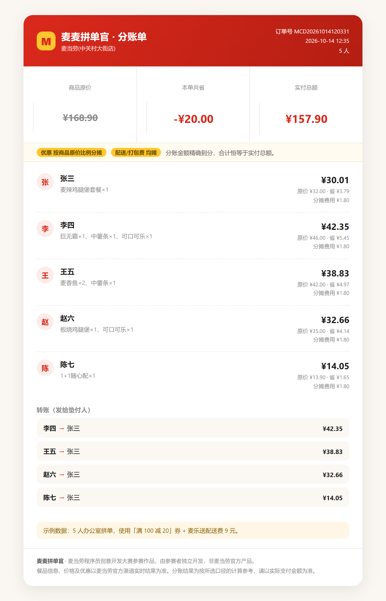

<div align="center">

# 🍟 麦麦拼单官

**群里 8 个人点麦当劳，从报单到算清「谁该转谁多少钱」，只要一次对话。**

把群聊记录丢进来 → 自动配最优券组合 → 一键下单 → 输出精确到分的 AA 分账图。

**MCP Token&#x20;**


</div>



---

## 拼单真正的麻烦，从来不是点单

点单只是一句话的事。麻烦在后面：

- **券怎么用最省？** 手里 7 张券，门槛、面额、能否叠加各不相同，凭感觉用一定不是最优解。
- **优惠怎么分才不吵架？** 满 100 减 20，是 5 个人均摊每人省 4 元？还是买得多的人省得多？  
  还是谁用自己的券谁受益？——这是拼单群里 90% 争执的来源。
- **账算不对。** 3 个人均摊 10 元配送费，每人 3.333… 元，四舍五入后合计 9.99，少的那一分谁补？

「麦麦拼单官」就是为这三件事做的。

---

## 它能做什么

| 能力            | 说明                                                                                   |
| ------------- | ------------------------------------------------------------------------------------ |
| 🗣 **报单解析**   | 直接粘贴群聊记录。支持 `@昵称` / `昵称：` / `昵称 ` 三种前缀，`x2`/`2个`/`两个` 三种数量写法，自动抽备注（去冰、不要生菜）          |
| 🎯 **菜单匹配**   | 把「中薯」「板烧」这类口语名，模糊匹配到门店真实餐品编码；拿不准的**不猜**，交回人工确认                                       |
| 💰 **券组合优化**  | 枚举候选券组合 → 调 `calculate-price` 权威试算 → 选出实付最低方案；还会提示「再加 ¥31.10 可用满 200 减 50，净省 ¥18.90」 |
| 🧾 **精确分账**   | 最大余额法分摊，**Σ(每人应付) 恒等于订单实付**，永不出现 0.01 尾差                                             |
| ⚖️ **三种分账口径** | 把「优惠怎么分」变成显式选项，而不是争吵点                                                                |
| 🖼 **分账卡片**   | 生成自包含 HTML，截图直接发群；含转账清单                                                              |

---

## 快速开始

### 1. 申请麦当劳 MCP Token

访问 [麦当劳 MCP 开放平台](https://open.mcd.cn/mcp) → 手机号登录 → 控制台 → 激活 → 复制 Token。

### 2. 在 WorkBuddy 中配置连接器

在 WorkBuddy 左侧边栏【专家·技能·连接器】→【连接器】→ 右上角【自定义连接器】→【配置 MCP】，  
填入 [`mcp-config.example.json`](./mcp-config.example.json) 的内容，**把 `${MCD_MCP_TOKEN}` 换成你的真实 Token**  
（或先设置同名环境变量），保存并启用。

### 3. 安装技能

```bash
git clone https://github.com/<your-name>/mcd-group-order.git
cp -r mcd-group-order/skills/mcd-group-order ~/.workbuddy-ai/skills/
```

### 4. 在对话里粘贴群聊记录

```
@张三 麦辣鸡腿堡套餐 x1
李四：巨无霸 + 中薯 + 可乐
@王五 2个麦香鱼 1份薯条 不要番茄酱
赵六：板烧鸡腿堡 去冰可乐
```

「麦麦拼单官」会依次完成：定位门店 → 拉菜单 → 匹配餐品 → 试算券组合 → 分账 → 出图。

---

## 三种分账口径

分账最容易吵架的不是「点了什么」，而是「优惠怎么分」。所以这里不替你做决定，而是把口径摆出来：

| 口径              | 权重     | 适合              |
| --------------- | ------ | --------------- |
| **按商品原价比例**（默认） | 各人商品金额 | 买得多的人分摊更多优惠，最公平 |
| **按人头均摊**       | 人人相等   | 大家金额差不多，图省事     |
| **谁用券谁受益**      | 券持有人独占 | 券是某人自己的，人情归人家   |

配送费/打包费另有一套口径（均摊 / 按比例）。

### 为什么不会出现 0.01 的尾差

金额全程以「分」为单位的**整数**运算，分摊使用**最大余额法**：

1. 按权重算理论份额 $r_i = T \cdot w_i / W$
2. 下取整得到 $b_i$
3. 余数 $R = T - \sum b_i$ 按小数部分从大到小，逐一分配 1 分

数学上 $\sum (b_i + \Delta_i) = T$ 恒成立。3 人均摊 10.00 元，结果必然是 `334 / 333 / 333`，合计恰好 1000 分。

代码里还会强制自检：任一条不变量被破坏就抛错中止，**不允许**带着不自洽的账单继续输出。

> 详细推导与输入输出结构见 [`references/split-algorithm.md`](./skills/mcd-group-order/references/split-algorithm.md)。

---

## 项目结构

```
mcd-group-order/
├── README.md                      # 本文件
├── CONTEST_DECLARATION.md         # 参赛声明（赛事要求，内容不可改动）
├── MCP_INTEGRATION.md             # MCP 工具映射、调用流程与业务价值
├── mcp-config.example.json        # 脱敏的 MCP 配置示例（仅环境变量占位符）
├── workbuddy.md                   # WorkBuddy 开发对话上下文
├── skills/mcd-group-order/        # 技能主体
│   ├── SKILL.md                   # 技能入口：触发条件与工作流编排
│   ├── scripts/
│   │   ├── parse_orders.py        # 群聊报单解析
│   │   ├── match_menu.py          # 口语名 → 餐品编码 模糊匹配
│   │   ├── plan_coupons.py        # 券组合候选生成与剪枝
│   │   ├── split_bill.py          # 分账引擎（最大余额法）
│   │   └── render_card.py         # 分账卡片渲染
│   └── references/
│       ├── order-format.md        # 报单文本格式与解析规则
│       └── split-algorithm.md     # 分账算法与输入输出结构
├── examples/                      # 示例输入与产物
└── tests/test_split_bill.py       # 单元测试（含 1500 组随机模糊测试）
```

## 本地测试

```bash
python -m unittest discover -s tests -v
```

覆盖：总额守恒、零尾差、三种口径一致性、优惠超过商品总额、单人参单、除不尽场景，  
以及 1500 组随机模糊测试。

## 用到的麦当劳 MCP 能力

`query-meals` `query-meal-detail` `query-nearby-stores` `delivery-query-stores` `query-store-coupons`  
`query-my-coupons` `available-coupons` `auto-bind-coupons` `calculate-price` `create-order`  
`query-order` `campaign-calendar` `query-meal-assistance` `list-nutrition-foods` `now-time-info` 等。

完整映射与调用流程见 [`MCP_INTEGRATION.md`](./MCP_INTEGRATION.md)。

**报单解析、菜单匹配、券候选生成、分账计算全部在本地完成**，单次拼单的 MCP 调用量控制在 20 次以内，远低于 600 次/分钟的限流阈值。

---

## 声明

- 本项目为**麦当劳程序员创意开发大赛参赛作品**，由参赛者独立开发，**非麦当劳官方产品**。
- 餐品信息、价格及优惠以麦当劳官方渠道的实时结果为准；分账结果为计算参考，请以实际支付金额为准。
- 项目不含任何真实 Token、密钥或他人个人信息，配置文件仅使用环境变量占位符。
- 涉及下单、领券等写操作时，均需用户明确确认后才执行。

## License

[MIT](./LICENSE)

---

<div align="center">

**如果这个项目帮你省下了一次和同事算账的时间，欢迎点个 ⭐ Star。**

</div>
